

  <a href="https://modwith.ai/aotd?utm_source=github&utm_medium=readme">
    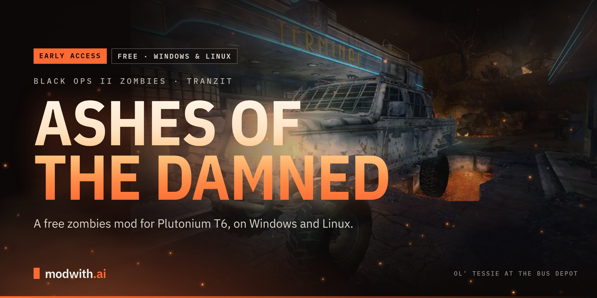
  </a>

  
  
  
  
  

  <a href="https://modwith.ai/aotd/releases?utm_source=github&utm_medium=readme">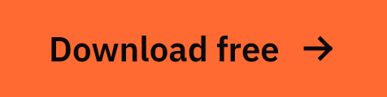</a>
  &nbsp;
  <a href="https://modwith.ai/discord?src=aotd&utm_source=github&utm_campaign=discord">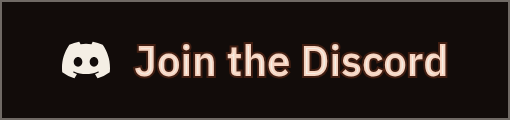</a>

  <a href="#reviews"><b>REVIEWS</b></a> &nbsp;·&nbsp;
  <a href="#survivors"><b>SURVIVORS</b></a> &nbsp;·&nbsp;
  <a href="#ravagers"><b>RAVAGERS</b></a> &nbsp;·&nbsp;
  <a href="#perks"><b>PERKS</b></a> &nbsp;·&nbsp;
  <a href="#ol-tessie"><b>OL' TESSIE</b></a> &nbsp;·&nbsp;
  <a href="#armory"><b>ARMORY</b></a> &nbsp;·&nbsp;
  <a href="#servers"><b>SERVERS</b></a> &nbsp;·&nbsp;
  <a href="#squad"><b>SQUAD</b></a> &nbsp;·&nbsp;
  <a href="#roadmap"><b>COMING IN 1.0</b></a> &nbsp;·&nbsp;
  <a href="#start"><b>START</b></a> &nbsp;·&nbsp;
  <a href="#changelog"><b>CHANGELOG</b></a> &nbsp;·&nbsp;
  <a href="#report"><b>REPORT</b></a>

  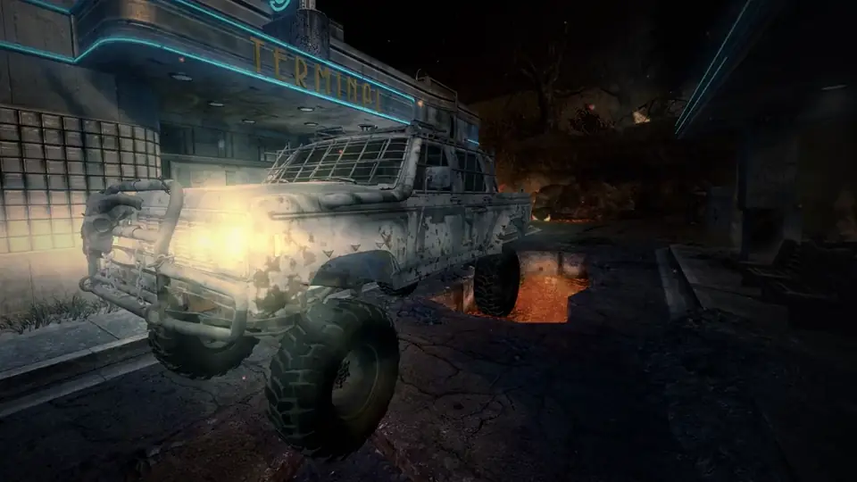

Our own build, in game. Ol' Tessie at the Bus Depot, the Necrofluid Gauntlet in a horde, a ride in Tessie's bed, a Ravager's lunge.

 

<picture>
  <source media="(prefers-color-scheme: dark)" srcset="https://raw.githubusercontent.com/SickoHours/aotd-releases/readme-assets/title-reviews-dark.webp">
  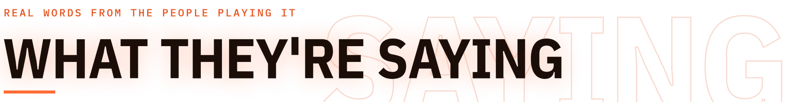
</picture>

<table>
  <tr>
    <td width="50%" valign="top">
      <h3>“We got the gauntlet on BO2 before GTA 6. […] This is really, really awesome. Talk about a peak freaking mod.”</h3>
      <b>SPIPPYAF</b> &nbsp;·&nbsp; <a href="https://www.youtube.com/watch?v=HJz1mNPjnVo">on YouTube</a>
    </td>
    <td width="50%" valign="top">
      <h3>“People, the new version of TranZit: definitely the best version of TranZit I've played. Thank you so much for including me in this.”</h3>
      <b>BIG ISA</b> &nbsp;·&nbsp; <a href="https://www.youtube.com/watch?v=rDVcHpbDwI4">on YouTube</a> &nbsp;·&nbsp; translated from Spanish
    </td>
  </tr>
  <tr>
    <td width="50%" valign="top">
      <h3>“I don't actually know how they've managed to put all of this in Black Ops 2, to be honest. It's quite mad.”</h3>
      <b>RAYNE</b> &nbsp;·&nbsp; <a href="https://www.youtube.com/watch?v=XUsPGtW_OR0&t=1657s">on stream, 27:37</a>
    </td>
    <td width="50%" valign="top">
      <h3>“This is honestly how Black Ops 7 should have been. […] I prefer playing this.”</h3>
      <b>BIG ISA &amp; JHORPYZ</b> &nbsp;·&nbsp; <a href="https://www.youtube.com/watch?v=rDVcHpbDwI4">together, on Big isa's video</a> &nbsp;·&nbsp; translated from Spanish
    </td>
  </tr>
  <tr>
    <td width="50%" valign="top">
      <h3>“Hey, even the Pack-a-Punch camo is different, I mean, that's incredible. It's beautiful. […] Man, if TranZit had been like this, seriously. A beauty.”</h3>
      <b>CODMILO</b> &nbsp;·&nbsp; <a href="https://www.youtube.com/watch?v=ocD6gRxdt6Q">on YouTube</a> &nbsp;·&nbsp; translated from Spanish
    </td>
    <td width="50%" valign="top">
      <h3>“What kind of insane mod is this, people? […] I hope they get a ton of support for bringing these things.”</h3>
      <b>JHORPYZ</b> &nbsp;·&nbsp; <a href="https://www.youtube.com/watch?v=6Gs2OCBvKII">on YouTube</a> &nbsp;·&nbsp; translated from Spanish
    </td>
  </tr>
</table>

<a href="https://modwith.ai/aotd?utm_source=github&utm_medium=readme#reviews"><b>Read every quote on modwith.ai →</b></a>

 

<picture>
  <source media="(prefers-color-scheme: dark)" srcset="https://raw.githubusercontent.com/SickoHours/aotd-releases/readme-assets/title-videos-dark.webp">
  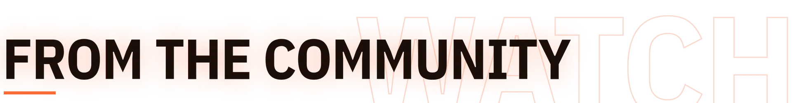
</picture>

<table>
  <tr>
    <td width="50%" valign="top">
      <a href="https://www.youtube.com/watch?v=HJz1mNPjnVo">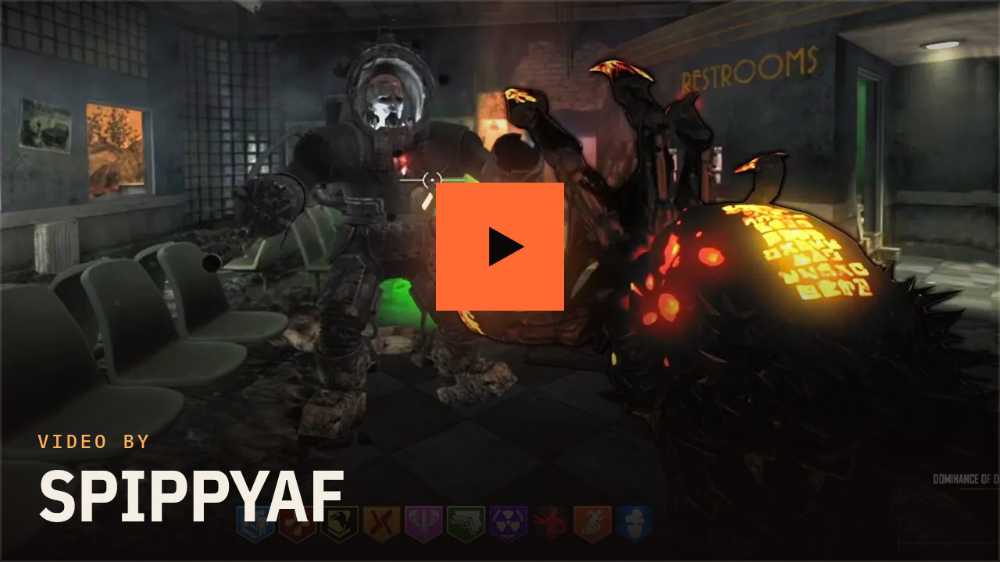</a>
       This Is The ULTIMATE Tranzit MOD! (New Black Ops 2 Zombies AOTD x Tranzit Mod + Download) · <a href="https://www.youtube.com/@spippyaf">SpippyAf</a>
    </td>
    <td width="50%" valign="top">
      <a href="https://www.youtube.com/watch?v=XUsPGtW_OR0">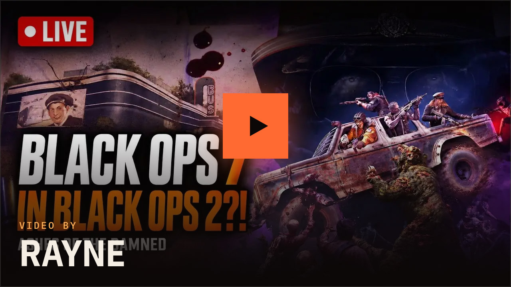</a>
       COD Zombies Modders Have Gone Insane… BO7 in Black Ops 2?! · <a href="https://www.youtube.com/@RayneMaliciousTV">Rayne</a>
    </td>
  </tr>
  <tr>
    <td width="50%" valign="top">
      <a href="https://www.youtube.com/watch?v=6Gs2OCBvKII">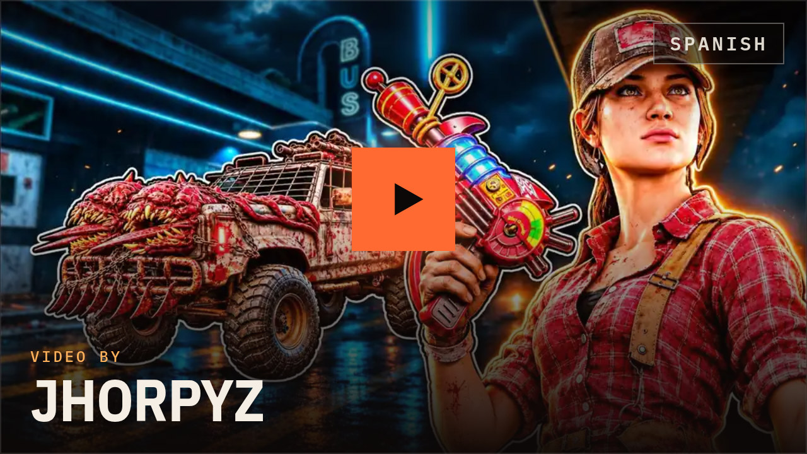</a>
       ¡EL NUEVO TRANZIT ACTUALIZADO en 2027! · <a href="https://www.youtube.com/@JhorpyZ">JhorpyZ</a>
    </td>
    <td width="50%" valign="top">
      <a href="https://www.youtube.com/watch?v=rDVcHpbDwI4">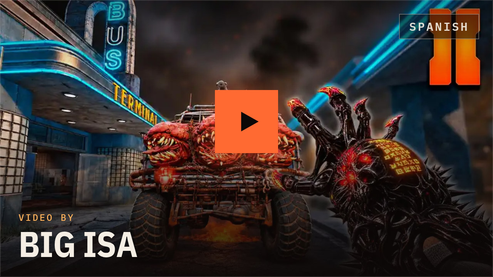</a>
       BO2 TRANZIT con TESSIE y ARMAS de BO7 · <a href="https://www.youtube.com/@big_isa">Big isa</a>
    </td>
  </tr>
</table>

 

<picture>
  <source media="(prefers-color-scheme: dark)" srcset="https://raw.githubusercontent.com/SickoHours/aotd-releases/readme-assets/title-survivors-dark.webp">
  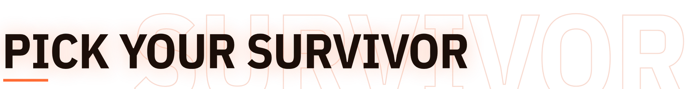
</picture>

  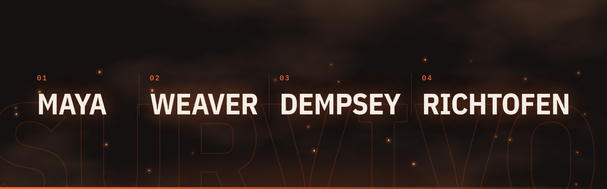

 

<picture>
  <source media="(prefers-color-scheme: dark)" srcset="https://raw.githubusercontent.com/SickoHours/aotd-releases/readme-assets/title-ravagers-dark.webp">
  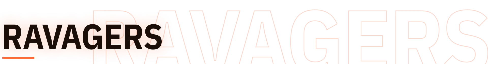
</picture>

  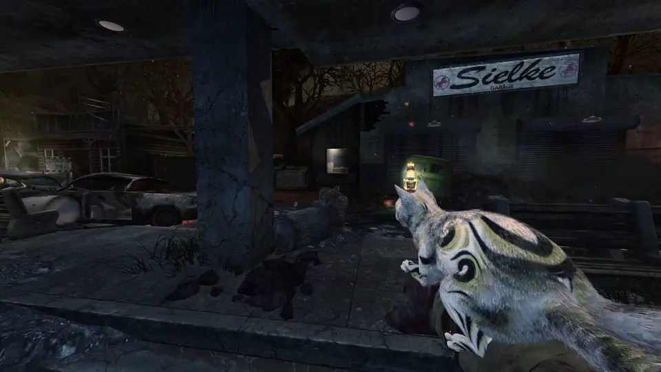

 

<picture>
  <source media="(prefers-color-scheme: dark)" srcset="https://raw.githubusercontent.com/SickoHours/aotd-releases/readme-assets/title-perks-dark.webp">
  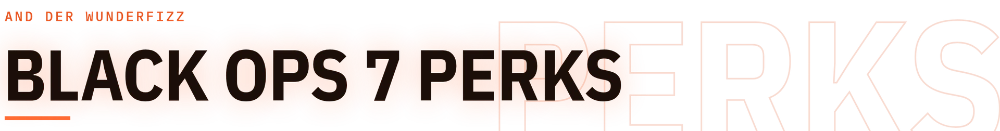
</picture>

  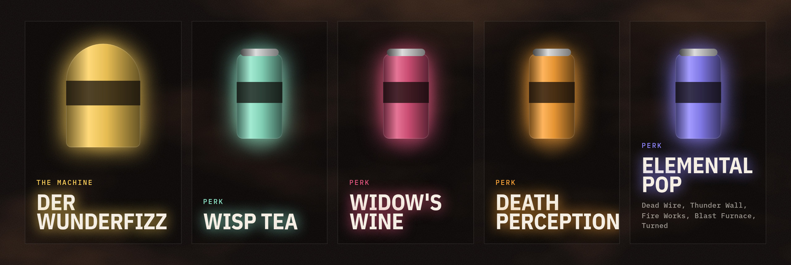

Black Ops 7 perks, each with its can. Der Wunderfizz and the perk machines, to look round.

 

<picture>
  <source media="(prefers-color-scheme: dark)" srcset="https://raw.githubusercontent.com/SickoHours/aotd-releases/readme-assets/title-tessie-dark.webp">
  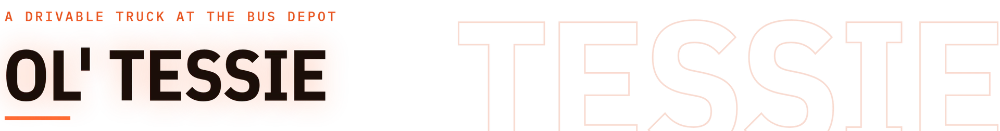
</picture>

  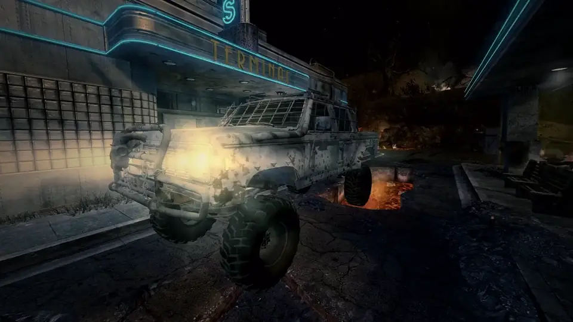

<table>
  <tr>
    <td width="50%" valign="top"><h3>A drivable truck at the Bus Depot, with crew seats and riders.</h3></td>
    <td width="50%" valign="top"><h3>Her DG-2 turret and Pack-a-Punch upgrades. A speed governor, and the DG-2's hum.</h3></td>
  </tr>
</table>

  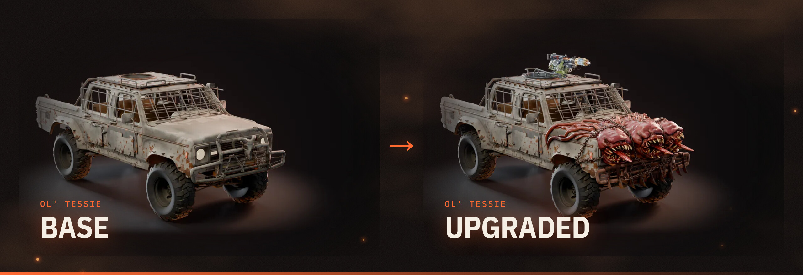

 

<picture>
  <source media="(prefers-color-scheme: dark)" srcset="https://raw.githubusercontent.com/SickoHours/aotd-releases/readme-assets/title-armory-dark.webp">
  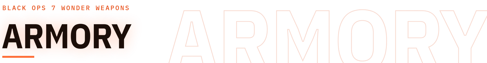
</picture>

  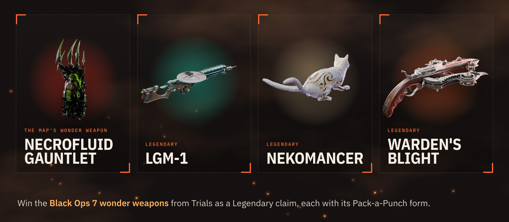

<table>
  <tr>
    <th align="left" width="34%">Necrofluid Gauntlet</th>
    <td>The map's wonder weapon. Build it at the bench in the Pack-a-Punch room, or get it from the box. Its Pack-a-Punch upgrade: Dominance of Dravakar.</td>
  </tr>
  <tr><th align="left">LGM-1 &nbsp;LEGENDARY</th><td>A saucer on a gun. Point it at the horde.</td></tr>
  <tr><th align="left">Nekomancer &nbsp;LEGENDARY</th><td>A cat-shaped gun. The horde catches fire.</td></tr>
  <tr><th align="left">Warden's Blight &nbsp;LEGENDARY</th><td>From Trials, as a Legendary claim.</td></tr>
  <tr><th align="left">Jötunn Star &nbsp;LEGENDARY</th><td>From Trials, as a Legendary claim.</td></tr>
  <tr><th align="left">Ray Gun Mk I &nbsp;BLACK OPS 7 VERSION</th><td>The Black Ops 7 Ray Gun.</td></tr>
  <tr><th align="left">Ray Gun Mk II &nbsp;BLACK OPS 7 VERSION</th><td>The Black Ops 7 Ray Gun Mk II.</td></tr>
  <tr><th align="left">Void Claw &nbsp;GRAPPLE</th><td>The grapple.</td></tr>
</table>

<a href="https://modwith.ai/aotd?utm_source=github&utm_medium=readme#armory"><b>Spin every one in 3D on modwith.ai →</b></a>

 

<picture>
  <source media="(prefers-color-scheme: dark)" srcset="https://raw.githubusercontent.com/SickoHours/aotd-releases/readme-assets/title-servers-dark.webp">
  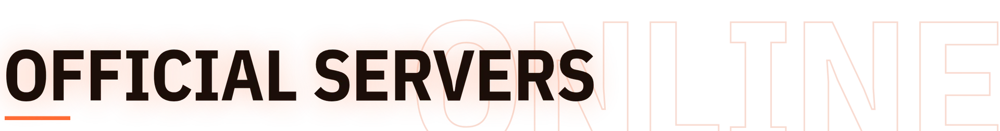
</picture>

  
  
  
  

Four official servers, live. Copy a join command from <a href="https://modwith.ai/aotd?utm_source=github&utm_medium=readme#servers"><b>modwith.ai/aotd</b></a> and paste it into the Plutonium console.

 

<picture>
  <source media="(prefers-color-scheme: dark)" srcset="https://raw.githubusercontent.com/SickoHours/aotd-releases/readme-assets/title-squad-dark.webp">
  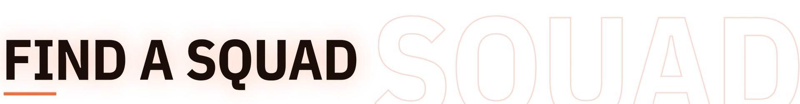
</picture>

<table>
  <tr>
    <td width="50%" valign="top">
      <h3>this is a co-op mod, built around the truck.</h3>
      the Discord is where people find a squad, hop in voice and play together. come join the community.
    </td>
    <td width="50%" valign="top">
      TEXT 
      <code>#</code> <b>aotd-lfg</b> &nbsp;find people to play with 
      <code>#</code> <b>aotd-chat</b> &nbsp;talk about the mod  
      VOICE 
      🔊 <b>Squad 1</b> 
      🔊 <b>Squad 2</b>
    </td>
  </tr>
</table>

  

 

<picture>
  <source media="(prefers-color-scheme: dark)" srcset="https://raw.githubusercontent.com/SickoHours/aotd-releases/readme-assets/title-roadmap-dark.webp">
  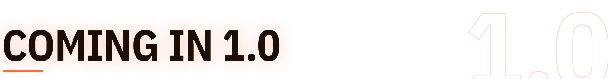
</picture>

| | What the full 1.0 release adds |
|:--:|:--|
| **01** | Black Ops 7 perk augments |
| **02** | Black Ops 7 specialist abilities (the LB+RB special) |
| **03** | the Mr. Peeks GobbleGum machine plus Black Ops 7 gums |
| **04** | the rest of the Black Ops 7 wonder weapons |
| **05** | more playable characters |
| **06** | hundreds more guns |
| **07** | a community-shaped Ashes-style quest using the truck, the Ravagers and the beam |

 

<picture>
  <source media="(prefers-color-scheme: dark)" srcset="https://raw.githubusercontent.com/SickoHours/aotd-releases/readme-assets/title-start-dark.webp">
  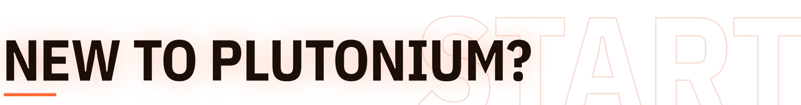
</picture>

1. Get Plutonium from its [official site](https://plutonium.pw/) and set up Black Ops II with its [install guide](https://plutonium.pw/docs/install/#t6-black-ops-2). You need a legitimate copy of the game, like the one on Steam.
2. [Download the mod](https://modwith.ai/aotd/releases?utm_source=github&utm_medium=readme) and follow the readme in the zip.
3. Open the Plutonium launcher and click **PLAY**.

Stuck? Ask on [Discord](https://modwith.ai/discord?src=aotd&utm_source=github&utm_campaign=discord) or [report a bug](#report).

 

  <a href="https://modwith.ai/aotd/releases?utm_source=github&utm_medium=readme">
    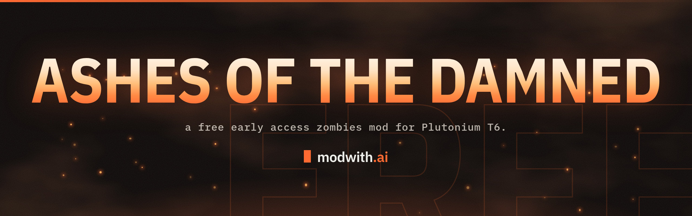
  </a>

Host a private match from the pregame lobby.

  
  &nbsp;
  

Get the mod only from <a href="https://modwith.ai/aotd/releases?utm_source=github&utm_medium=readme">modwith.ai</a>. Every file there is checksummed in the release record the download page reads. This repository holds no downloads.

 

<picture>
  <source media="(prefers-color-scheme: dark)" srcset="https://raw.githubusercontent.com/SickoHours/aotd-releases/readme-assets/title-changelog-dark.webp">
  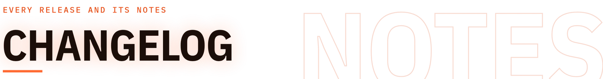
</picture>

This repository is the public changelog: one tagged release per version, each with its notes and its known issues.

<table>
  <tr>
    <td width="33%" valign="top" align="center">
      <h3><a href="CHANGELOG.md">CHANGELOG.md</a></h3>
      every version, newest first
    </td>
    <td width="33%" valign="top" align="center">
      <h3><a href="https://github.com/SickoHours/aotd-releases/releases">Releases</a></h3>
      each version's notes, one per tag
    </td>
    <td width="33%" valign="top" align="center">
      <h3><a href="https://modwith.ai/aotd/releases?utm_source=github&utm_medium=readme">modwith.ai/aotd/releases</a></h3>
      the download, install help and what's new
    </td>
  </tr>
</table>

  
  

Watch this repository (<b>Watch → Custom → Releases</b>) to hear about every new version.

 

<picture>
  <source media="(prefers-color-scheme: dark)" srcset="https://raw.githubusercontent.com/SickoHours/aotd-releases/readme-assets/title-report-dark.webp">
  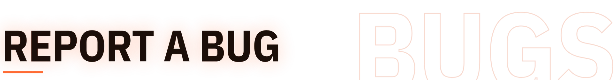
</picture>

Stuck or found a bug? Post in [#aotd-bugs](https://discord.com/channels/1564314983259701288/1570273752564891668) on [our Discord](https://modwith.ai/discord?src=aotd&utm_source=github&utm_campaign=discord), or [file an issue here on GitHub](https://github.com/SickoHours/aotd-releases/issues/new/choose).

  <a href="https://modwith.ai/discord?src=aotd&utm_source=github&utm_campaign=discord">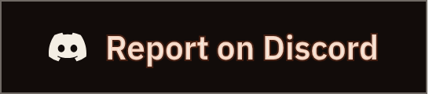</a>

 

<picture>
  <source media="(prefers-color-scheme: dark)" srcset="https://raw.githubusercontent.com/SickoHours/aotd-releases/readme-assets/title-credits-dark.webp">
  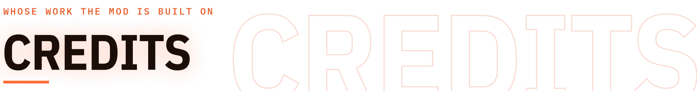
</picture>

Ashes of the Damned is built on other people's work. Thank you to everyone here.

<b>Community creators</b>

 

| Who | What the mod took from them |
|:--|:--|
| [techboy04](https://github.com/techboy04/Gobblegums-T6Zombies) | GobbleGum. His T6 GobbleGum implementation is the community mod our gum system grew from. Its TranZit machine spots are in the map, the Bus Depot gum machine among them. |
| Kosmoes (with Bashiro) | GobbleGum assets from [Chronicles Reawakened v3.5](https://forum.plutonium.pw/topic/41496): the gum machine, the gum models and weapons, and the Death Machine. |
| [DavidHiFi (T6-QoL, with Synarxis)](https://github.com/DavidHiFi/T6-QoL) | T6-QoL 2.20.1 (MIT). The starting pistols as his zone ships them: the Bloodhound, TAC-45, Browning HP and Browning HP Dual Wield, plus the Peacekeeper. Instant Pack-a-Punch's give and busy handling. The ideas behind the HUD readouts, flash messages and exit sequence. |
| vuflub_ | [ONE ROOM[HARD]](https://steamcommunity.com/sharedfiles/filedetails/?id=3756600477), a Black Ops III workshop map: the five alternate ammo types (Blast Furnace, Dead Wire, Fire Works, Thunder Wall, Turned), their HUD glyphs, and the game-over screen pattern. From his maps: Wisp Tea, the BO3 Widow's Wine with its web grenade, and the BO3 PhD Flopper. |
| [Scobalula](https://github.com/Scobalula/Bo3CWStyleItemDrops) | Bo3CWStyleItemDrops: the idea of a per-item trigger with a time to live, used for dropped guns. |
| [DoktorSAS](https://github.com/DoktorSAS/Recompilable-gscs-for-BO2-zombies-and-multiplayer) | Recompilable GSCs for BO2, a recompilable dump of the stock scripts. The stock Pack-a-Punch checks come from it, and Ol' Tessie's truck script builds on it. His menu popup is the pattern for the Der Wunderfizz and Legendary screens. |
| [DevUltimateman](https://github.com/DevUltimateman/BO2-TranZit-Reimagined-2020-Source-Codes) | TranZit Reimagined 2020 (Colder Days): the film-tweak route behind the night grade. |
| Ahrimdon | The forum release "[All BO2 Zombies xModels + Images](https://forum.plutonium.pw/topic/18568)", which supplied 31 lobby gun pictures (Treyarch menu art). |
| [Omnibus-Type (The Saira Project Authors)](https://github.com/Omnibus-Type/Saira) | The Saira typeface, cut into the mod's two menu fonts. |
| [Halo / SickoHours](https://github.com/SickoHours) | The mod: design, direction and every play verdict. His own work also includes the Bloodhound and Meat Wagon port from Black Ops III (credited in T6-QoL) and the T6 GobbleGum conversion. |

<b>Tools</b>

 

| Tool | By | What for |
|:--|:--|:--|
| [Plutonium (T6)](https://plutonium.pw) | the Plutonium team | The client and dedicated server the mod runs on, its server browser and its download-on-join. |
| [OpenAssetTools](https://github.com/Laupetin/OpenAssetTools) | Laupetin and contributors (GPL-3.0) | Builds and reads back every zone. |
| [gsc-tool](https://github.com/xensik/gsc-tool) | xensik | Compiles and decompiles the GSC and CSC scripts. |
| [Blender](https://blender.org) | Blender Foundation | Model and animation conversion. |
| Cast | DTZxPorter | Model and animation exchange format and Blender add-on. |
| [PyCoD](https://github.com/SE2Dev/PyCoD) | SE2Dev and contributors (MIT) | Model conversion for the Gauntlet glove. |
| [GrayWolf](https://github.com/Kenshin9977/GrayWolf) | Kenshin9977 (GPL-3.0), on Greyhoundx by dest1yo, Greyhound by Scobalula and Wraith Archon by DTZxPorter | BO7 asset extraction. |
| [Greyhound](https://github.com/Scobalula/Greyhound) | Scobalula | The BO4 Icons capture (crew icons), and BO3 and BO4 layouts. |
| [Cordycep](https://github.com/Scobalula/Cordycep) | Scobalula, maintained by dest1yo and the Scob Crew | Loading BO7 for export. |
| Saluki and porter-lib | echo000 and DTZxPorter | BO7 image and model export. |
| [Atian COD Tools](https://github.com/ate47/atian-cod-tools) | ate47, with contributor Kenshin9977 | BO3 workshop map reads, the BO7 script decrypt, and alternate ammo references. |
| [FFmpeg](https://ffmpeg.org) | FFmpeg project | Audio encode and inspect. |

<a href="https://modwith.ai/aotd?utm_source=github&utm_medium=readme#credits"><b>Every credit and license on modwith.ai →</b></a>

 

  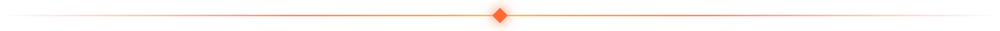

  <a href="https://modwith.ai/aotd?utm_source=github&utm_medium=readme"><b>modwith.ai/aotd</b></a> &nbsp;·&nbsp;
  <a href="https://modwith.ai/aotd/releases?utm_source=github&utm_medium=readme"><b>Download</b></a> &nbsp;·&nbsp;
  <a href="https://modwith.ai/discord?src=aotd&utm_source=github&utm_campaign=discord"><b>Discord</b></a> &nbsp;·&nbsp;
  <a href="CHANGELOG.md"><b>Changelog</b></a> &nbsp;·&nbsp;
  <a href="#top"><b>Back to top ↑</b></a>

Call of Duty: Black Ops II and its assets are the property of Activision and Treyarch. This project is unofficial and not affiliated with or endorsed by Activision, Treyarch or Plutonium. You must own a legitimate copy of Black Ops II to use it. It contains no leaked files.

